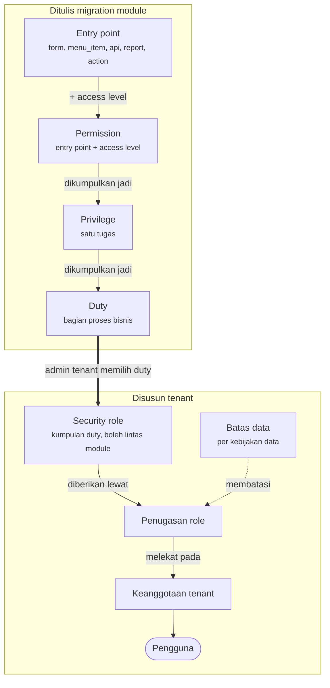

# Rantai keamanan modul transaksi

Saat membuat transaksi baru, keamanannya tidak diputuskan belakangan. Ada empat lapis yang **ditulis migration module**, lalu lapis yang **disusun tenant** sebelum hak itu sampai ke seorang pengguna. Model aksesnya lengkap di [Identity dan access](09-identity-and-access.md).

## Rantainya

## Empat lapis di migration module

Mengikuti [role-based security Dynamics 365](https://learn.microsoft.com/en-us/dynamics365/fin-ops-core/dev-itpro/sysadmin/role-based-security).

| Lapis | Tabel | Arti | Pola kode |
| --- | --- | --- | --- |
| Entry point | `app_entry_points` | Yang dilindungi | `<module>.<resource>.<form\|api>` |
| Permission | `permissions` | Entry point + access level | `<module>.<resource>.<aksi>` |
| Privilege | `security_privileges`, `security_privilege_permissions` | Satu tugas | `<module>.<resource>.<tugas>` |
| Duty | `security_duties`, `security_duty_privileges` | Bagian proses bisnis | `<module>.<resource>.<proses>` |

`type` entry point: `form`, `menu_item`, `api`, `report`, `action`. Access level permission: `read`, `update`, `create`, `correct`, `delete`, `invoke`. Aksi penghapusan lunak seperti arsipkan, void, atau retire memakai `delete`; operasi layanan tanpa makna CRUD memakai `invoke`.

Di CoreERP lapis ini dideklarasikan manifest `app.yaml` yang divalidasi saat didaftarkan. Repo ini tidak punya manifest. Module menulis katalognya di migration-nya sendiri dengan `INSERT ... ON CONFLICT DO NOTHING`, dalam berkas yang sama dengan baris `apps` module itu. Contoh lengkapnya `modules/healthcare/database/migrations/0001_patient.sql`, yang juga mendaftarkan kebijakan data, peran party, referensi nomor, dan tujuan hierarchy module itu. Core menulis katalognya sendiri di `database/migrations/`.

Migration module dijalankan saat module dipasang, dan pemasangan memberi role pemilik tenant semua duty module itu. Kodenya `installModule` di `src/platform/environment/`.

## Contoh utuh: satu master

Diambil dari master pasien. Kode finalnya milik migration module, bukan dibuat dari layar tenant.

| Lapis | Isi |
| --- | --- |
| Entry point | `healthcare.patient.form` untuk layar, `healthcare.patient.api` untuk pendaftaran dan perubahan |
| Permission | `.read`, `.create`, `.update`, `.delete`, masing-masing dengan access level-nya |
| Privilege | `view` = read; `register` = read + create; `maintain` = read + update; `retire` = read + delete |
| Duty | `healthcare.patient.inquire` = view; `healthcare.patient.manage` = register + maintain + retire |
| Security role | Disusun admin tenant dari duty yang dibutuhkan |
| Batas data | Unit kerja menurut kebijakan `healthcare.patient-unit` |

Pemisahan `maintain` dan `retire` menjadi dua privilege yang membuat tenant dapat memberi hak mengubah tanpa hak menghapus. Kalau keduanya digabung, pilihan itu hilang.

## Lapis yang disusun tenant

Yang berikut bukan bagian migration module dan tidak dibatasi ke satu module:

- **Security role**: disusun admin tenant dari duty, termasuk duty module lain.
- **Penugasan role**: pemberian role ke satu keanggotaan.
- **Batas data**: batas kebijakan data pada penugasan itu.

Role tidak punya `module_id` dan tidak dimiliki department.

## Aturan yang tidak boleh dilanggar

**Empat lapis disimpan sebagai empat baris berbeda.** Kode privilege tidak boleh sama dengan kode permission-nya. Kalau disamakan, rantai runtuh menjadi satu lapis bersalin tiga, dan tenant kehilangan kemampuan memberi satu tugas tanpa memberi seluruh duty. CoreERP menolak manifest semacam itu saat didaftarkan; repo ini belum punya pemeriksa otomatis, jadi aturan ini dijaga di review migration.

**`access_level` selalu ditulis eksplisit.** Tidak pernah ditebak dari potongan kode permission.

**Permission menyatakan kemampuan bisnis, bukan visibilitas menu.** Menyembunyikan tombol bukan pengamanan; procedure tetap memanggil `guard`.

**Hierarchy role menyusun tanggung jawab, bukan organisasi.** Ia graph berarah tanpa siklus. Module tidak perlu mengetahuinya: `Workspace` sudah memperluas role turunan sebelum menghitung permission.

**Kode yang sudah dipakai adalah kontrak.** Permission, duty, dan kebijakan data yang sudah dipegang role tenant tidak diganti nama di tempat. Mengganti nama mencabut akses dari setiap role yang memegangnya tanpa peringatan. Menghapus duty yang dipakai role butuh migration yang lebih dulu melepas relasi role-duty-nya.

## Yang disediakan Core

| Kemampuan | Di mana | Artinya bagi perancang module |
| --- | --- | --- |
| Pemeriksaan izin per procedure | `Workspace.guard` | Setiap procedure memeriksa permission-nya sendiri |
| Penelusuran katalog | `/sysadmin/access/security-configuration` | Nama duty yang kabur terlihat kabur oleh admin tenant |
| Penyusunan role dan akses anggota | `/sysadmin/access/roles`, `/sysadmin/access/staff` | Duty yang terlalu lebar langsung terlihat saat diberikan |
| Pemisahan tugas | `assertNoSodConflict` saat penugasan manual diubah | Pasangan duty yang konflik ditolak bila ada aturannya |

Pemisahan tugas punya batas yang harus diingat. Aturannya disimpan per tenant di `sod_rules`, tetapi layar untuk mengaturnya, mitigasi, dan catatan konflik belum ada. Kalau module-mu memerlukan pemisahan tugas, rancang pasangan duty-nya, tetapi jangan bergantung pada penegakan otomatis di semua jalur.

## Checklist untuk satu transaksi

- [ ] Entry point-nya: form, menu item, procedure API, report, action
- [ ] Permission per entry point, dengan access level eksplisit
- [ ] Privilege: tugas yang dikerjakan orang, bukan cerminan tabel
- [ ] Duty: bagian proses bisnis yang menampung privilege itu
- [ ] Role tenant yang masuk akal disusun dari duty itu, ditulis di README module walaupun role-nya dibuat admin tenant
- [ ] Perlukah kebijakan data? Hanya bila resource-nya memang perlu dibatasi organisasi
- [ ] Perlukah pemisahan tugas? Hanya bila pengaju tidak boleh sekaligus memverifikasi atau menyetujui
- [ ] Perlukah workflow? Hanya untuk persetujuan, pengecualian, keputusan berisiko, atau serah terima terkendali
- [ ] Perlukah nomor? Hanya untuk dokumen transaksi atau master utama yang dicari lewat kodenya

Empat butir pertama wajib. Sisanya diputuskan sadar, termasuk keputusan "tidak perlu", dan keputusan itu ikut dicatat.

## Lihat juga

- [Identity dan access](09-identity-and-access.md)
- [Gate penemuan dan keputusan](18-module-discovery-and-decision-gate.md)
- [Query scope dan schema](08-query-scopes-and-schema.md)
