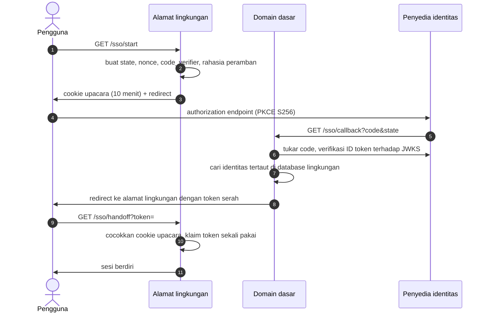

# SSO: masuk lewat penyedia identitas

Halaman ini menjelaskan bagaimana SSO bekerja di runtime ini: alur, alamat, penjaga, dan setelannya. Kodenya di `src/platform/identity/`, terutama `oidc.ts` dan `sso.service.ts`, dengan tabel dari `database/migrations/0022_sso.sql`. Ringkasan aturannya juga ada di bagian Masuk lewat SSO `AGENTS.md`.

Sisi konsol, yaitu login operator admin.erp, identitas pusat, undangan, dan MFA, milik [control-plane-metta](https://github.com/MettaDevs/control-plane-metta). Runtime dan konsol adalah dua klien OIDC berbeda pada penyedia yang sama; ID token untuk satu klien tidak diterima klien lain karena `aud`-nya berbeda.

## Anggapan yang keliru

| Anggapan | Yang sebenarnya |
| --- | --- |
| Identitas ditautkan lewat email | Tidak pernah. Tautannya `iss` + `sub` di `external_identities`. Email di penyedia dapat dipilih sendiri oleh penyerang |
| Masuk lewat SSO membuatkan akun | Tidak. Identitas yang belum tertaut ditolak dengan pesan untuk masuk dengan kata sandi lalu menautkan dari halaman Profil. Pengguna baru dari identitas SSO hanya lahir lewat operasi worker `sync_identities` |
| Alamat balik ada di alamat lingkungan | Alamat balik satu per penempatan, di domain dasar |
| Menyalakan SSO menutup kata sandi | Tidak. Keduanya hidup berdampingan |

## Alur tiga kaki, dua alamat



**Kenapa ada kaki ketiga.** Penyedia mencocokkan alamat balik persis tanpa wildcard, sedangkan setiap lingkungan punya alamatnya sendiri. Kaki ketiga membawa hasilnya kembali ke alamat lingkungan. Cookie sesi tidak menyeberang antar-alamat, jadi upacara membawa rahasia peramban sendiri di cookie `__Host-sso-ceremony`. Token serah saja tidak cukup; ia harus datang dari peramban yang memulai. Tanpa itu, tautan yang bocor dari log atau riwayat menjadi sesi.

Upacara dicatat di `sso_attempts` **di database runtime**, karena alamat balik dipakai bersama semua lingkungan di host ini. Lingkungannya dikenali dari `tenant_slug` dan jenis lingkungan. Pengguna dan tautan identitas tetap di database lingkungan. `sso_login_attempts` dari baseline CoreERP tidak dipakai, karena foreign key-nya menunjuk tabel yang di sini tinggal di database lain.

Yang disimpan hanya hash: `state`, rahasia peramban, nonce, dan token serah. `code_verifier` disimpan terenkripsi dengan `APP_KEY`. Token serah sekali pakai, dan klaimnya satu `UPDATE` bersyarat, sehingga dua tab yang berlomba menghasilkan paling banyak satu sesi. Baris yang sudah kedaluwarsa lebih dari sehari dibuang saat upacara baru dimulai.

Mode upacara ditulis di `SsoMode`, misalnya `login` dan `link`. Mode `link` dimulai dari halaman Profil untuk menautkan akun yang sedang masuk, dan kaki ketiganya menulis `external_identities` untuk pengguna itu.

Portal yang membuka sebuah lingkungan cukup menautkan ke `/sso/start` di alamat lingkungan itu. Sesi di penyedia dipakai ulang.

## Yang diperiksa sebelum sesi berdiri

- **`state`** acak, disimpan sebagai hash, sekali pakai. Yang tidak dikenal ditolak sebelum kode ditukar, karena penukaran menghubungi penyedia dan tidak boleh dipicu tamu.
- **PKCE S256**, tanpa jalur `plain`. `response_type` hanya `code`.
- **Penerbit.** Dokumen discovery wajib menyebut `issuer` yang sama persis dengan setelan. ID token wajib membawa `iss` yang sama dan `aud` yang memuat client id runtime ini.
- **Tanda tangan** RS256 terhadap JWKS penyedia, dengan toleransi jam satu menit. JWKS disimpan di memori proses, dan `kid` yang tidak dikenal memicu satu pengambilan ulang sebelum ditolak, supaya kunci yang baru dirotasi tidak membuat semua orang gagal masuk.
- **Nonce** selalu dikirim. Bila ada di ID token, wajib cocok. Bila tidak ada, diterima karena PKCE sudah mengikat permintaan, sama dengan klien OIDC control plane.
- **Keunikan tautan.** Satu identitas hanya menunjuk satu pengguna, dan satu pengguna hanya punya satu identitas per penerbit. Dua indeks unik parsial di `external_identities` menjaganya.
- **Menautkan menuntut kata sandi diketik ulang.** Tanpa itu, peramban yang ditinggalkan terbuka cukup untuk memasang identitas penyerang pada akun korban. Tautan boleh dilepas selama akun masih punya kata sandi; melepasnya mengisi `deleted_at`.

Setiap kegagalan mengembalikan pengguna ke halaman masuk atau Profil dengan **kode tetap**, misalnya `unlinked` atau `expired`. Daftarnya `SsoErrorCode` di `sso.service.ts`. Halaman menerjemahkan kode itu ke kalimatnya sendiri dan tidak pernah mencetak teks dari alamat. Alamat kembali sesudah masuk dibatasi ke alamat di aplikasi ini.

## Back-channel logout

Penyedia mengirim `POST https://<BASE_DOMAIN>/sso/backchannel-logout` berisi logout token. Tidak ada CSRF karena pengirimnya server; yang menjaganya pemeriksaan token:

- tanda tangan, `iss`, `aud`, `iat`, dan `exp`;
- wajib memuat event back-channel logout dan menyebut `sub`, dan dilarang memuat `nonce`;
- umur paling lama lima menit;
- `jti` sekali pakai, dicatat di `sso_logout_tokens` di database runtime.

Token yang sah mengakhiri sesi semua pengguna yang tertaut ke `sub` itu **di setiap lingkungan host ini**, termasuk database bersama. `users.sessions_revoked_at` diisi dan baris di tabel `sessions` dihapus. Sesi di Valkey tidak dapat dicari per pengguna, jadi sesi yang login sebelum waktu pencabutan dibaca sebagai belum login di request berikutnya. Mekanismenya di [Cache dan sesi](36-cache-and-sessions.md#logout-dan-pencabutan). Satu database yang gagal tidak menghalangi lingkungan lain.

## Operasi `sync_identities`

Control plane memberi tahu lingkungan identitas mana milik pengguna mana lewat operasi worker `sync_identities`, kodenya di `src/platform/environment/sync-identities.service.ts`.

- Hanya menambah tautan dan aman diulang. Tautan yang sudah ada, termasuk yang dipasang pengguna sendiri dari Profil, tidak dilepas.
- `user_id` yang diisi menautkan pengguna yang sudah ada dan menjadikannya anggota tenant, misalnya admin pertama.
- `user_id` kosong membuat pengguna baru tanpa kata sandi, dengan keanggotaan aktif tanpa role.
- Tidak ada yang ditautkan karena emailnya sama. Email yang sudah dipakai pengguna lain menggagalkan operasi.

Pengguna tanpa kata sandi ditolak login kata sandi dengan pesan yang sama dengan kata sandi salah.

## Setelan

| Kunci | Catatan |
| --- | --- |
| `SSO_ISSUER`, `SSO_CLIENT_ID`, `SSO_CLIENT_SECRET` | Isi ketiganya atau kosongkan ketiganya. Kosong berarti SSO mati: semua `/sso/*` dijawab 404 dan halaman masuk hanya menampilkan kata sandi |
| `BASE_DOMAIN` | Wajib bila SSO menyala, karena alamat balik diturunkan darinya |

Alamat yang didaftarkan di penyedia, satu pasang per penempatan:

```text
https://<BASE_DOMAIN>/sso/callback
https://<BASE_DOMAIN>/sso/backchannel-logout
```

Di laptop, dengan `BASE_DOMAIN=localhost` atau `*.localhost`, skema dan port mengikuti request, misalnya `http://localhost:8000/sso/callback`. Salah mendaftar di sini muncul sebagai kegagalan di sisi penyedia, jauh dari kodenya.

Domain dasar tanpa nama tenant hanya melayani alamat SSO di atas. Request lain ke sana dijawab seperti alamat yang tidak dikenal.

## Menguji

Test SSO memakai penyedia OIDC tiruan di `test/support/oidc-provider.ts` yang menandatangani token dengan kunci RSA sungguhan, bukan token palsu. Test-nya di `test/platform/identity/`.

## Yang belum ada

- Masuk dengan undangan terikat akun SSO, yang di CoreERP adalah pintu ketiga upacara ini. Undangan milik control plane.
- Pengecualian SSO per tenant dan penyedia milik pelanggan. Di runtime ini SSO menyala atau mati per penempatan.
- Langkah MFA sesudah login kata sandi.

## Lihat juga

- [Identity dan access](09-identity-and-access.md)
- [Cache dan sesi](36-cache-and-sessions.md)
- [Grand design](01-grand-design.md#alamat-menentukan-lingkungan)
